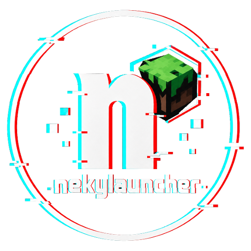
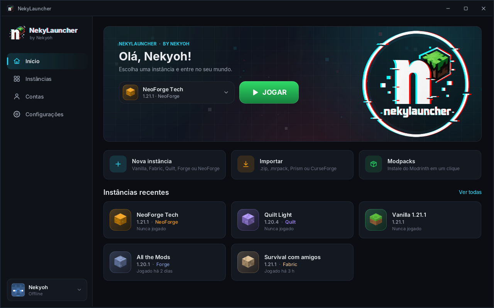
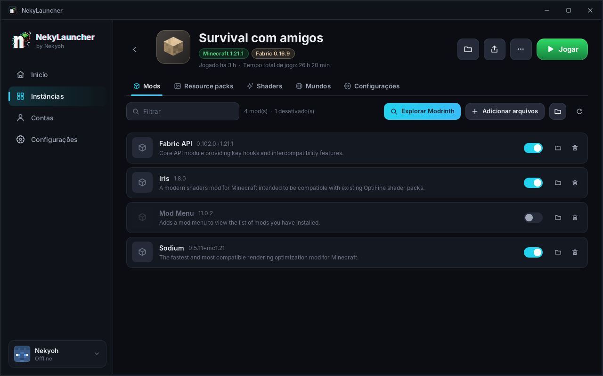
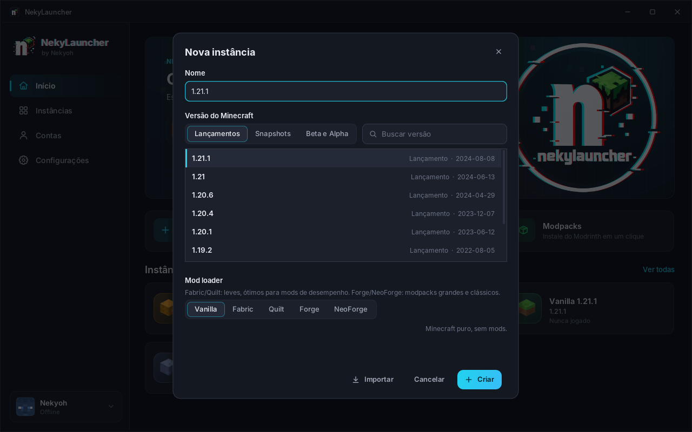

<p align="center">
  
</p>

<h1 align="center">NekyLauncher</h1>
<p align="center"><b>by Nekyoh</b> — launcher de Minecraft: Java Edition para Windows e Linux</p>

<p align="center">
  
</p>

## O que ele faz

- **Minecraft original** — login com a conta **Microsoft** que tem o jogo, em um clique pelo navegador (como no MultiMC/Prism).
- **Instâncias isoladas** — cada uma com sua versão, mod loader, mods, resource packs, shaders, mundos e configurações. O ícone padrão é o logo do loader (bigorna do Forge, raposa do NeoForge, Fabric, Quilt — baixados do GitHub oficial de cada projeto) e dá pra trocar por qualquer imagem.
- **Mod loaders nativos** — Fabric, Quilt, Forge e NeoForge instalados direto pelo launcher (o instalador do Forge/NeoForge roda em modo headless, com os processors, igual ao instalador oficial).
- **Abas de conteúdo** — *Mods*, *Resource packs*, *Shaders* e *Mundos*: **arraste e solte** o arquivo e ele vai pra pasta certa; ative/desative mods; veja nome, versão e ícone lidos de dentro do `.jar`/`.zip`.
- **Modrinth integrado** — busque e instale mods/packs/shaders compatíveis com a versão e o loader da instância, já com as **dependências obrigatórias**; instale **modpacks** em um clique; botão “Instalar Iris” na aba de shaders.
- **Java certo automaticamente** — baixa o mesmo runtime que o launcher oficial usa para cada versão (Java 8, 17, 21…). Ou escolha um Java instalado, o **Java do launcher oficial** (é detectado) ou aponte para qualquer `javaw.exe`/`java`.
- **Exportar/Importar .zip** — exporte uma instância escolhendo o que vai junto; importe `.zip` do NekyLauncher, **`.mrpack` (Modrinth)**, instâncias do **Prism/MultiMC** e modpacks do **CurseForge**.
- **Console do jogo** com cores por nível de log (lê os eventos XML do log4j como o launcher oficial), botão de parar, abrir pasta de logs.
- **Interface em Português, English e Español** (troca na hora, em Configurações).
- Zero dependências externas e **nada de JavaScript**: Java 21 + Swing com UI 100% desenhada à mão (tema escuro, ícones vetoriais, fonte Inter). O pacote final traz o próprio Java — o usuário não precisa instalar nada.

<p align="center">
  
  
</p>

## Publicar no GitHub e gerar os executáveis

O repositório já tem um workflow (`.github/workflows/build.yml`) que **compila, testa e gera os executáveis de Windows e Linux sozinho** a cada push. Você não precisa de nada instalado além do Git.

1. Crie um repositório vazio em <https://github.com/new> (ex.: `nekylauncher`, sem README).
2. Na pasta do projeto:
   ```bash
   git init
   git add .
   git commit -m "NekyLauncher 1.0.0"
   git branch -M main
   git remote add origin https://github.com/SEU_USUARIO/nekylauncher.git
   git push -u origin main
   ```
3. Quando a Mojang aprovar seu app, adicione o client ID como *secret*: **Settings › Secrets and variables › Actions › New repository secret**, nome `NEKY_MS_CLIENT_ID`, valor = o client ID.
4. Rode de novo o build: aba **Actions › Build › Run workflow** (ou faça qualquer push).
5. Os arquivos ficam na execução do workflow, em **Artifacts**: `NekyLauncher-Windows` (zip portátil e, se houver WiX, instalador) e `NekyLauncher-Linux` (tar.gz e .deb).

Para publicar uma versão, crie um *Release* (aba Releases › Draft a new release) e anexe esses arquivos.

### Gerar no seu PC (opcional)

Precisa do **JDK 21** ([Eclipse Temurin](https://adoptium.net/)). Coloque o client ID em `gradle.properties` (`msClientId=...`) ou na variável de ambiente `NEKY_MS_CLIENT_ID` e rode:

- Windows: `powershell -ExecutionPolicy Bypass -File packaging\package-windows.ps1` → `dist\NekyLauncher-windows-x64.zip`
- Linux: `bash packaging/package-linux.sh` → `dist/NekyLauncher-linux-x64.tar.gz`
- Só testar: `./gradlew run` · testes: `./gradlew selfTest`

## Login Microsoft (conta original)

Para quem usa o launcher é **um clique**, igual ao MultiMC/Prism: *Contas › Microsoft* abre o navegador na página da Microsoft, a pessoa entra e volta — pronto. (Também tem a opção "Entrar com código em outro dispositivo", via `microsoft.com/link`.) A senha nunca passa pelo launcher.

Isso funciona porque o MultiMC/Prism embutem no programa o **client ID** deles, aprovado pela Mojang. Você faz o mesmo **uma vez só**, como dono do NekyLauncher:

1. Em <https://portal.azure.com> → *App registrations* → *New registration*: tipo de conta **“Personal Microsoft accounts only”**.
2. Em *Authentication* → *Add a platform* → **Mobile and desktop applications** → URI de redirecionamento **`http://localhost`**; e ative **“Allow public client flows”** (para o login por código).
3. Peça a liberação para a API do Minecraft no formulário da Mojang: <https://aka.ms/mce-reviewappid>.
4. Coloque o *client ID* no secret `NEKY_MS_CLIENT_ID` do GitHub (ou em `gradle.properties`, `msClientId=...`). Todo build gerado já sai com ele e ninguém precisa configurar nada. Sem ele, o launcher abre normalmente mas avisa que o login ainda não está configurado.

Não use o client ID de outro launcher: cada app precisa do próprio. O campo em *Configurações › Login Microsoft* continua existindo só para quem quiser usar outro app.

## Onde ficam os arquivos

| Sistema | Pasta |
|---|---|
| Windows | `%APPDATA%\.nekylauncher` |
| Linux | `~/.local/share/nekylauncher` (ou `$XDG_DATA_HOME/nekylauncher`) |
| Portátil | crie um arquivo `portable.txt` ao lado do launcher → tudo vai para `data/` ali mesmo |

Para trocar o local (por exemplo para outro disco), use **Configurações › Armazenamento › Alterar local…**. O launcher move tudo (instâncias, mundos, Java, downloads) — no mesmo disco é instantâneo — e reinicia já usando a pasta nova. Se algo falhar no meio, os arquivos voltam para o lugar antigo. "Restaurar padrão" traz tudo de volta.

Bibliotecas, assets e runtimes Java são compartilhados entre instâncias; cada instância tem sua pasta `instances/<nome>/minecraft`.

## Estrutura do código

```
src/main/java/com/nekyoh/nekylauncher/
  game/      manifesto de versões, regras, bibliotecas, assets, natives, linha de comando, processo do jogo
  java/      detecção de Java e runtimes da Mojang/Temurin
  loader/    Fabric, Quilt, Forge, NeoForge (incluindo os processors do instalador)
  auth/      Microsoft (navegador ou código → Xbox → XSTS → Minecraft)
  instance/  instâncias, leitura de metadados de mods/packs, exportar/importar
  modrinth/  API do Modrinth com dependências
  ui/        janela, páginas, diálogos e o kit visual (tema, botões, ícones…)
src/main/resources/nekylauncher/i18n/  traduções (en, pt, es)
```

## Licença

Código sob a licença **MIT** (veja `LICENSE`). O nome e a logo do NekyLauncher não fazem parte da licença MIT (veja `NOTICE.md`).
A fonte Inter é distribuída sob a SIL Open Font License 1.1.

**NÃO É UM PRODUTO OFICIAL DO MINECRAFT. NÃO É APROVADO NEM ASSOCIADO À MOJANG OU À MICROSOFT.**
O launcher não distribui arquivos do jogo: tudo é baixado dos servidores oficiais pelo próprio computador do usuário.
